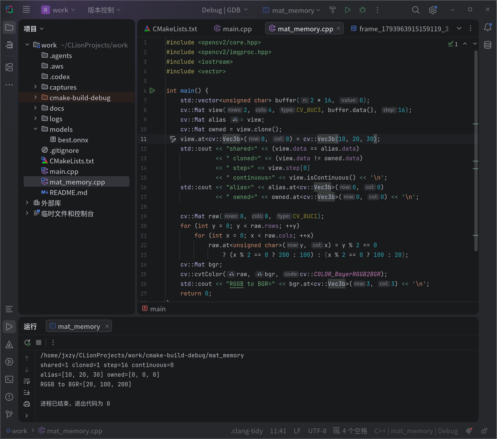

# 内存与错误处理实验记录

日期：2026-11-06。相机：MV-CS016-10UC，USB，序列号 DA4302122。

## 课堂内存示例

已在 CLion 运行 `mat_memory`。下列输出从用户提供的有效运行截图转录，截图显示退出码为 0：

```text
shared=1 cloned=1 step=16 continuous=0
alias=[10, 20, 30] owned=[0, 0, 0]
RGGB to BGR=[20, 100, 200]
```



- `view` 包装外部 buffer；`alias = view` 只复制图像头，两者共享像素，修改 view 后 alias 也改变。
- `owned = view.clone()` 复制像素，因此先前克隆的 owned 仍为零；`cloned=1` 验证数据指针不同。
- 每行有效像素为 4×3=12 字节，步长为 16 字节，因此 `continuous=0`。
- Bayer RGGB 测试图转换后按 B、G、R 顺序为 20、100、200。
- SDK 缓冲区也属于外部内存：包装它的 Mat 不会延长其有效期；必须在归还之前完成转换或深拷贝，归还后只使用独立像素内存。

另两张截图运行目标仍为 mat_memory，虽然填有相机参数，但未执行相机错误测试，因此不作为错误处理证据。下文使用随后真正运行 work 得到的原始日志。

## 真实相机：受控超时模拟

CLion 的运行目标为 `work`，程序实参：

```text
--serial DA4302122 --frames 30 --headless --no-yolo --simulate timeout
```

先正常处理 3 帧，再在下一次借用 SDK 缓冲区之前主动注入超时；不额外借用第 4 帧。日志中的错误为 `GetImageBuffer failed, code=0x80000007`。

实际结果：成功处理 3 帧，借出 3、归还 3；模拟触发标志为 1。随后停止采集、关闭相机、销毁句柄、释放 SDK 均成功。性能 CSV 中采集状态为 -2147483641，对应本次注入的错误码。

证据：[原始运行日志](../logs/run_1793965248028964_1.log)；[本次运行 CSV](../logs/performance_1793965248234947_1.csv)。

## 真实相机：受控格式错误模拟

程序实参：

```text
--serial DA4302122 --frames 30 --headless --no-yolo --simulate format
```

先正常处理 3 帧，借用第 4 帧后，在用于转换的元数据副本中注入不支持的像素格式。转换报告 `Unsupported pixel format`，仍以原始帧信息归还 SDK 缓冲区。

实际结果：成功处理 3 帧，借出 4、归还 4；模拟触发标志为 1。随后停止采集、关闭相机、销毁句柄、释放 SDK 均成功。性能 CSV 中采集状态为 -1，表示转换流程报告失败。

证据：[原始运行日志](../logs/run_1793965302469960_1.log)；[本次运行 CSV](../logs/performance_1793965302683209_1.csv)。

## 检查结论

| 检查 | 超时模拟 | 格式错误模拟 |
| --- | --- | --- |
| 实际运行相机 | DA4302122 | DA4302122 |
| 错误注入已触发 | 是 | 是 |
| 成功处理帧数 | 3 | 3 |
| 借出 / 归还 | 3 / 3 | 4 / 4 |
| 停止采集 | 成功 | 成功 |
| 关闭相机 | 成功 | 成功 |
| 销毁句柄 | 成功 | 成功 |
| 释放 SDK | 成功 | 成功 |

两次测试均报告了预定错误，并完成资源清理。它们是连接真实相机时的软件受控注入，不是拔线测试或真实设备故障。程序设计的预期进程退出码为 1；错误日志属于测试预期，不代表程序崩溃。

本次采样时间很短且故意触发错误，CSV 中的 FPS/CPU/耗时只作运行附带记录，不用于正常性能对比。归还计数相等及清理成功日志是本次资源检查证据，不等于全面内存泄漏检测。

测试完成后，将 work 实参恢复为正常采集参数，例如：

```text
--serial DA4302122 --exposure 1000 --gain 0
```
